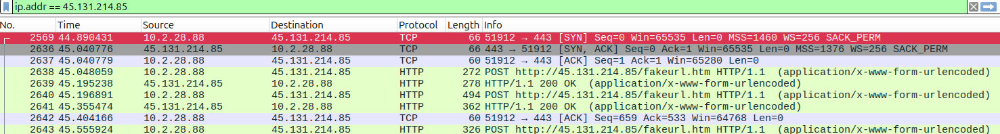
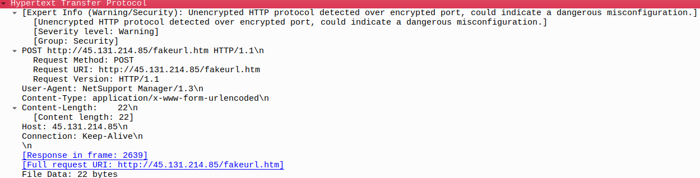
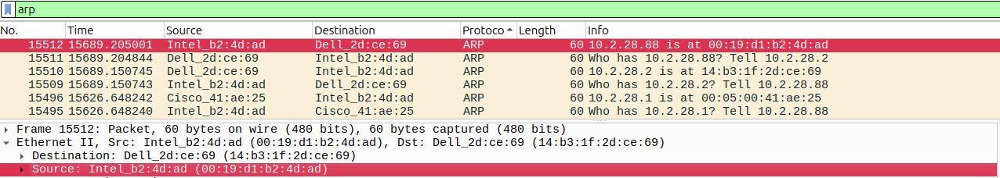
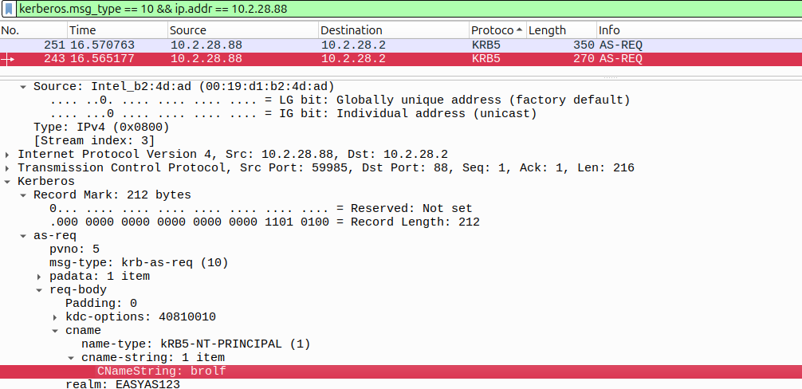
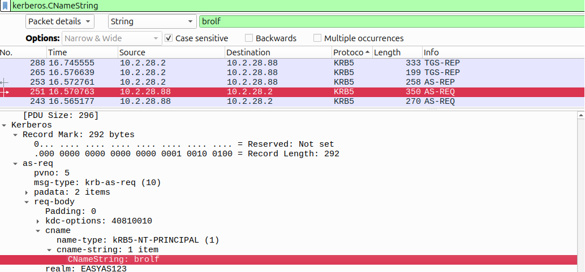
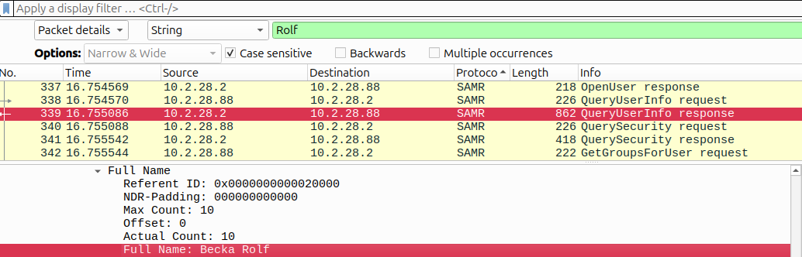

# Incident Investigation: NetSupport Manager RAT
<br><br>

## Overview

This investigation analyzes a packet capture associated with alerts for **NetSupport Manager RAT** communicating from the internal network to the external IP address `45.131.214.85` over TCP port `443`.

The objective is to identify the infected Windows client and correlate network-level evidence with Windows/Active Directory information.

### Environment

| Item | Value |
|---|---|
| Sample |  `2026-02-28-traffic-analysis-exercise.pcap` |
| Source | http://malware-traffic-analysis.net/
| LAN segment | `10.2.28.0/24` |
| Domain | `easyas123.tech` |
| AD environment | `EASYAS123` |
| Domain Controller | `10.2.28.2` (`EASYAS123-DC`) |
| Gateway | `10.2.28.1` |
| Suspected external IP | `45.131.214.85` |
<br>

### Tasks

For this investigation, we will have to determine the following:

**1.** Identify the IP address of the infected Windows client<br>
**2.** Identify the MAC address of the infected Windows client<br>
**3.** Identify the hostname of the infected Windows client<br>
**4.** Determine the Windows user account from the infected Window's client<br>
**5.** Determine the full name of the user from the user account<br>
<br><br>

# 1. Identify the IP address of the infected Windows client
The investigation began by filtering the capture for traffic involving the external IP address to isolate all packets exchanged and determine which internal system was communicating with it.


`ip.addr == 45.131.214.85`



We can see a TCP connection between 10.2.28.88 and 45.131.214.85 over dst port 443. After the TCP three-way handshake, the internal host sends multiple HTTP POST requests to `http://45.131.214.85/fakeurl.htm`.<br>
The presence of HTTP traffic over TCP port 443 is noteworthy, as this port is normally associated with HTTPS.


### HTTP characteristics

Inspection of the HTTP request reveals several indicators of interest:

- Request method: `POST`
- Destination: `45.131.214.85`
- URI: `/fakeurl.htm`
- User-Agent: `NetSupport Manager/1.3`
- Content-Type: `application/x-www-form-urlencoded`
- Connection: `Keep-Alive`



As I mentioned above, Wireshark also generates the following Expert Info warning:
> Unencrypted HTTP protocol detected over encrypted port, could indicate a dangerous misconfiguration.

**This warning should not be interpreted by itself as proof of malicious activity.** However, in this context it is significant because the traffic is associated with the external IP identified in the SIEM alert and the User-Agent explicitly identifies **NetSupport Manager**.

The combination of the suspicious destination, plaintext HTTP over port 443, repeated POST requests, and NetSupport Manager User-Agent provides strong evidence that this communication is related to the reported RAT activity.

<br><br>


# 2. Identify the MAC address of the infected Windows client

The internal source identified during the investigation is `10.2.28.88`. I examined ARP traffic to correlate this IP address with a Layer 2 address.

The ARP exchange contains the response:

```text
10.2.28.88 is at 00:19:d1:b2:4d:ad
```



The Ethernet header of the same packet confirms:

```text
Source MAC: 00:19:d1:b2:4d:ad
Source IP: 10.2.28.88
```

Therefore, the MAC address associated with the infected client is: **`00:19:d1:b2:4d:ad`**

<br><br>

# 3. Identify the hostname of the infected Windows client

A display filter was used to isolate NetBIOS Name Service traffic. And the resulting packets show the host registering several NetBIOS names, including `DESKTOP-TEYQ2NR<00>`.

```text
nbns && ip.addr == 10.2.28.88
```
**.



Within the request, Wireshark exposes the Kerberos client principal:

```text
CNameString: brolf
Realm: EASYAS123
```

This identifies the user account involved in the authentication exchange as **`brolf`**

A second inspection/search confirms the same account name in the Kerberos `CNameString` field.



<br><br>


# 5. Determine the full name of the user from the user account

We have now some useful information but the account name alone does not provide the user's full name. To correlate the Windows account with its directory information, the capture was searched for the string: `Rolf`.

This led to a SAMR `QueryUserInfo` response containing the user's directory attributes.

The relevant field is:

```text
Full Name: Becka Rolf
```



This provides the final identity correlation:

```text
Account: brolf
Full Name: Becka Rolf
```

<br><br>


# 6. Evidence Correlation

The evidence collected from different protocols can now be correlated into a single host identity:

| Evidence | Finding |
|---|---|
| Suspicious internal IP | `10.2.28.88` |
| External C2 / suspicious destination | `45.131.214.85:443` |
| MAC address | `00:19:d1:b2:4d:ad` |
| Hostname | `DESKTOP-TEYQ2NR` |
| Domain | `EASYAS123` |
| User account | `brolf` |
| User full name | `Becka Rolf` |
| Suspicious User-Agent | `NetSupport Manager/1.3` |
| HTTP URI | `http://45.131.214.85/fakeurl.htm` |

The different protocols provide complementary evidence:

```text
HTTP
  ↓
Suspicious external communication
  ↓
10.2.28.88
  ↓
ARP → 00:19:d1:b2:4d:ad
  ↓
NBNS → DESKTOP-TEYQ2NR
  ↓
Kerberos → brolf
  ↓
SAMR → Becka Rolf
```

This cross-protocol correlation allows the network activity to be tied to a specific Windows workstation and user.

<br><br>

# Conclusion

The packet capture provides sufficient evidence to identify the Windows client associated with the NetSupport Manager RAT alerts.

The infected endpoint is **`DESKTOP-TEYQ2NR` (`10.2.28.88`)**, with MAC address **`00:19:d1:b2:4d:ad`**. The observed authentication traffic identifies the Windows account **`brolf`**, which is correlated through SAMR with the full name **Becka Rolf**.

The communication with **`45.131.214.85:443`**, combined with plaintext HTTP, repeated POST requests to `/fakeurl.htm`, and the `NetSupport Manager/1.3` User-Agent, provides the primary network evidence supporting the investigation.

The identified endpoint should be treated as compromised and isolated for further investigation, with additional analysis focused on persistence, process execution, initial access, and any other systems contacted by the host.
