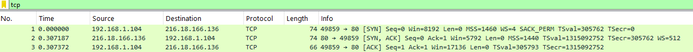
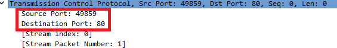
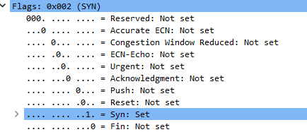
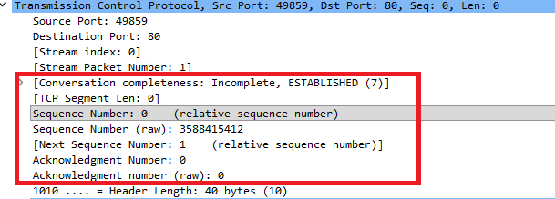
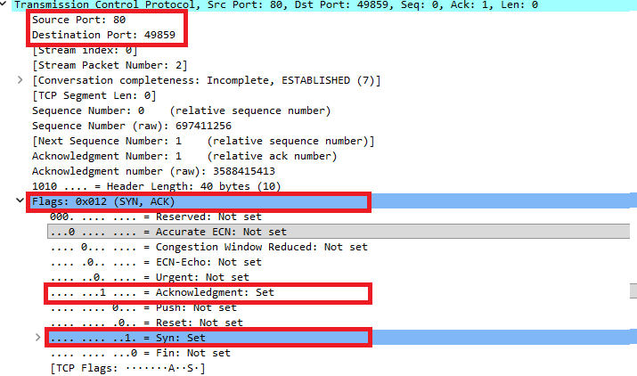
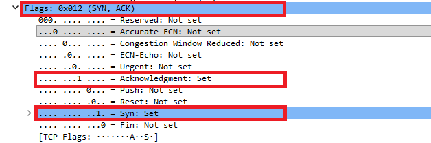
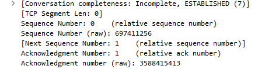
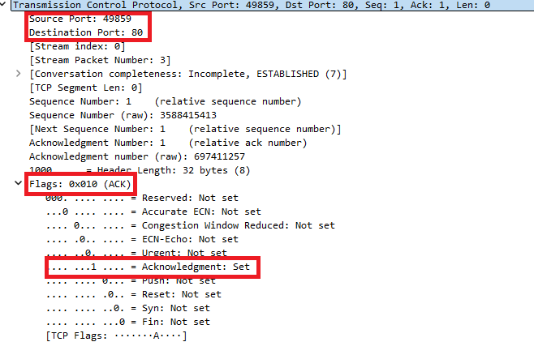
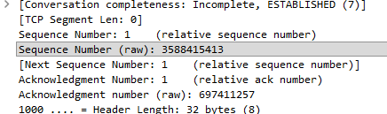
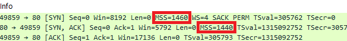

# TCP Three-Way Handshake Analysis
<br>

# 1. Objective

The objective of this investigation is to analyze how TCP establishes a connection through the **Three-Way Handshake**.

Rather than relying only on the theoretical sequence `SYN → SYN/ACK → ACK`, this investigation reconstructs the handshake directly from packet-level evidence captured in a PCAP file.

The analysis focuses on:

- Identifying the hosts participating in the communication.
- Identifying source and destination ports.
- Understanding the role of the `SYN` and `ACK` flags.
- Analyzing TCP Sequence Numbers and Acknowledgment Numbers.
- Understanding how both endpoints synchronize their sequence spaces.
- Reconstructing the complete TCP connection establishment process using Wireshark.
<br><br><br>


---
# 2. Environment & Tools

| Item | Details |
|---|---|
| Tool | Wireshark |
| Operating System | Windows 11 Pro |
| Capture format | PCAP |
| Analysis type | Network Traffic Analysis |
<br><br><br>


---
# 3. Initial Triage

The first step was to inspect the captured traffic and identify the protocol involved in the communication.

The following Wireshark display filter was applied:

```text
tcp
```


The purpose of this filter is to reduce the displayed traffic to TCP packets and make the relevant communication easier to inspect.

<!-- ### 📸 Screenshot 01 - filtro tcp -->

After applying the filter, three packets were visible. Their `Info` fields indicated a sequence of the TCP's connection-establishment process:

```text
SYN → SYN/ACK → ACK
```


This suggests that the capture contained a TCP Three-Way Handshake.
<br><br>

### Hosts identified

| Role | IP Address | Port |
|---|---|---:|
| Client | `192.168.1.104` | `49859` |
| Server | `216.18.166.136` | `80` |



The client uses the ephemeral source port `49859` and initiates a connection toward TCP port `80` on the remote host. This provides the first piece of evidence for the investigation.
<br><br><br>

---

# 4. Packet 1 | SYN

The first packet is transmitted in the form of src ip:port -> dst ip:port

```text
192.168.1.104:49859
        ↓
216.18.166.136:80
```

<!-- ### 📸 screenshot -->

The client initiates the TCP connection by setting the `SYN` flag.
<br><br>

### 4.1 TCP Flags

The TCP flags indicate that this packet is a SYN segment, marking the beginning of the TCP connection establishment process.



```text
SYN = Set
ACK = Not Set
```

<!-- ### 📸 screenshot -->

The `SYN` flag is used to initiate TCP connection establishment.

At this point, the client is not acknowledging previously received TCP data from the server. This is why the acknowledgment number is `0`.

<br><br>


### 4.2 Sequence and Acknowledgment Numbers

The packet contains:

| Field | Value |
|---|---:|
| Sequence Number (raw) | `3588415412` |
| Sequence Number (relative) | `0` |
| Acknowledgment Number (raw) | `0` |
| Acknowledgment Number (relative) | `0` |



The distinction between **raw** and **relative** sequence numbers is important when working with Wireshark. <br>
The raw value represents the actual 32-bit sequence number transmitted in the TCP header. Wireshark can also display relative sequence numbers, which simplify the analysis by presenting the beginning of the TCP conversation as `0`.

In this investigation, both values are useful because the relative values make the sequence easier to understand, while the raw values allow the actual TCP fields to be examined.

The important point is that TCP is not simply saying "I want to connect." It is also beginning the sequence-number synchronization process that will allow the two endpoints to keep track of the data exchanged during the connection.


<br><br>

---

# 5. Packet 2 | SYN/ACK

The second packet travels in the opposite direction. Notice that the source and destination ports have been reversed.

```text
216.18.166.136:80
        ↓
192.168.1.104:49859
```


<br><br>

The server responds with two flags:

```text
SYN = Set
ACK = Set
```



The hexadecimal value is a representation of the TCP flags field. It is not an arbitrary identifier assigned to the packet.<br>
This is why the packet is commonly referred to as **SYN/ACK**. The server is performing two actions simultaneously:

1. Acknowledging the client's SYN.
2. Sending its own SYN to establish its own sequence number.

<br><br>

### 5.1 Sequence and Acknowledgment Numbers

The observed values are:

| Field | Value |
|---|---:|
| Sequence Number (raw) | `697411256` |
| Sequence Number (relative) | `0` |
| Acknowledgment Number (raw) | `3588415413` |
| Acknowledgment Number (relative) | `1` |



<br>

The relationship between the first two packets is important:

```text
Client Sequence Number
3588415412
       +
       1
       ↓
Server Acknowledgment Number
3588415413
```

The server is acknowledging the client's SYN and indicating that it expects the next sequence number from the client to be `3588415413` (3588415412 + 1).

A key detail is that a SYN consumes one sequence number even though it does not contain application data.

This packet is the most informative packet of the handshake because it combines two functions.

<br><br><br>

---

# 6. Packet 3 | ACK

The third packet travels from the client back to the server:

```text
192.168.1.104:49859
        ↓
216.18.166.136:80
```
<br>




Unlike the previous packet, this one contains only the `ACK` flag.

The client is now acknowledging the server's SYN.
<br><br>

### 6.1 Sequence and Acknowledgment Numbers

The observed values are:

| Field | Value |
|---|---:|
| Sequence Number (raw) | `3588415413` |
| Sequence Number (relative) | `1` |
| Acknowledgment Number (raw) | `697411257` |
| Acknowledgment Number (relative) | `1` |

The client's sequence number is:

```text
3588415413
```


This is the value previously indicated by the server's acknowledgment:

```text
Ack = 3588415413
```

The client is therefore continuing from the sequence number that the server indicated it expected.

The acknowledgment number follows the same logic in the opposite direction:

```text
Server Sequence Number
697411256
       +
       1
       ↓
Client Acknowledgment Number
697411257
```

The client is acknowledging the server's SYN.


**This packet represents the final step of the Three-Way Handshake.** The client acknowledges the server's SYN, completing the synchronization of both sequence spaces.

At this point, both endpoints have acknowledged the initial SYN received from the other side, and the TCP connection is considered established.

The key evidence is:

```text
Client Seq: 3588415412
Server Ack: 3588415413

Server Seq: 697411256
Client Ack: 697411257
```

Both sequence spaces have therefore been successfully synchronized.
<br><br><br>

---

# 7. Reconstructing the Three-Way Handshake

The three packets can now be reconstructed into a single sequence:

```text
CLIENT                                      SERVER
192.168.1.104                              216.18.166.136
Port 49859                                 Port 80

     SYN
     Seq = 3588415412
──────────────────────────────────────────────>

                              SYN + ACK
                              Seq = 697411256
                              Ack = 3588415413
<──────────────────────────────────────────────

     ACK
     Seq = 3588415413
     Ack = 697411257
──────────────────────────────────────────────>
```

This reconstruction shows that the handshake is not simply a three-packet exchange.

Each packet has a specific role in synchronizing the sequence numbers used by the two endpoints.

<br><br><br>
---

## Other TCP Options Observed

During the analysis, several TCP options were observed within the handshake packets.

| TCP Option | Observed |
|---|---|
| Maximum Segment Size (MSS) | Yes |
| Window Scale | Yes |
| SACK Permitted | Yes |
| Timestamps | Yes |


The observed MSS values were:

```text
Client → Server: 1460 bytes
Server → Client: 1440 bytes
```




These options are negotiated during TCP connection establishment and provide additional parameters that can influence how the connection operates. For example, the MSS value communicates the maximum TCP payload size an endpoint is prepared to receive.<br>

Although these options are not the main focus of the investigation, their presence demonstrates that the TCP handshake can also be used to negotiate additional connection parameters.

This decision keeps the investigation focused on its main objective: understanding and reconstructing the TCP Three-Way Handshake.
<br><br><br>

---

# 10. Conclusion

> **The TCP Three-Way Handshake is both a connection-establishment mechanism and a sequence-number synchronization process.**

This investigation demonstrated how a TCP connection can be reconstructed directly from packet-level evidence.

Rather than treating the Three-Way Handshake as simply:

```text
SYN → SYN/ACK → ACK
```

the packet analysis showed the purpose of each message and how TCP synchronizes sequence numbers between both endpoints.

The investigation demonstrated the following process:

1. The client initiates the connection with a `SYN` and establishes its initial sequence number.
2. The server responds with `SYN + ACK`, acknowledging the client's SYN while establishing its own sequence number.
3. The client responds with `ACK`, acknowledging the server's SYN.
4. Both endpoints are now synchronized and the TCP connection is established.

The analysis also demonstrated how Wireshark's relative sequence numbers can simplify packet analysis while the raw values provide the actual sequence numbers transmitted in the TCP headers.

<br><br><br>